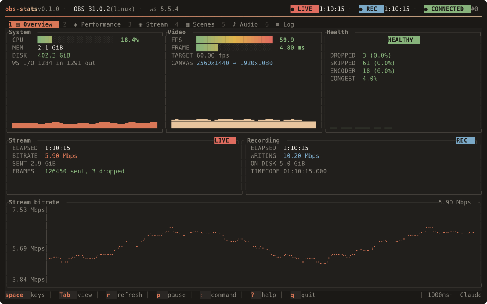
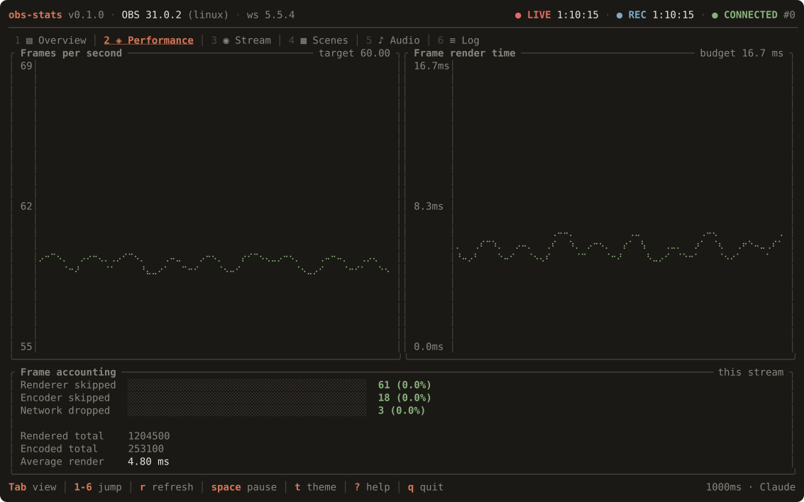
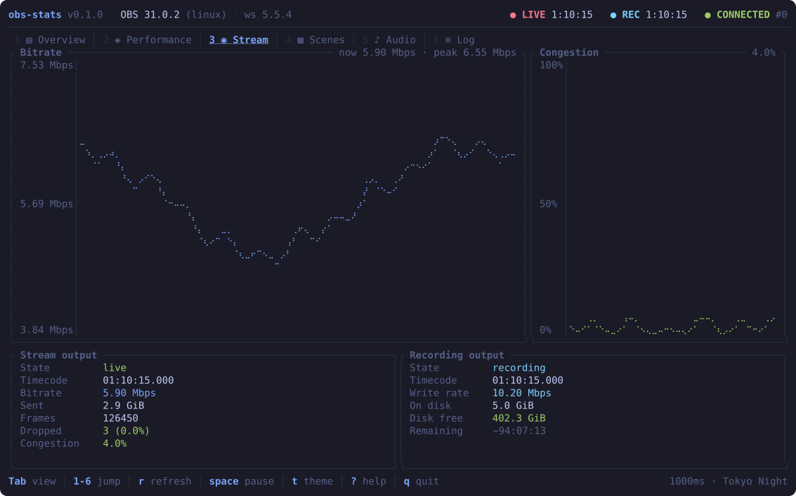
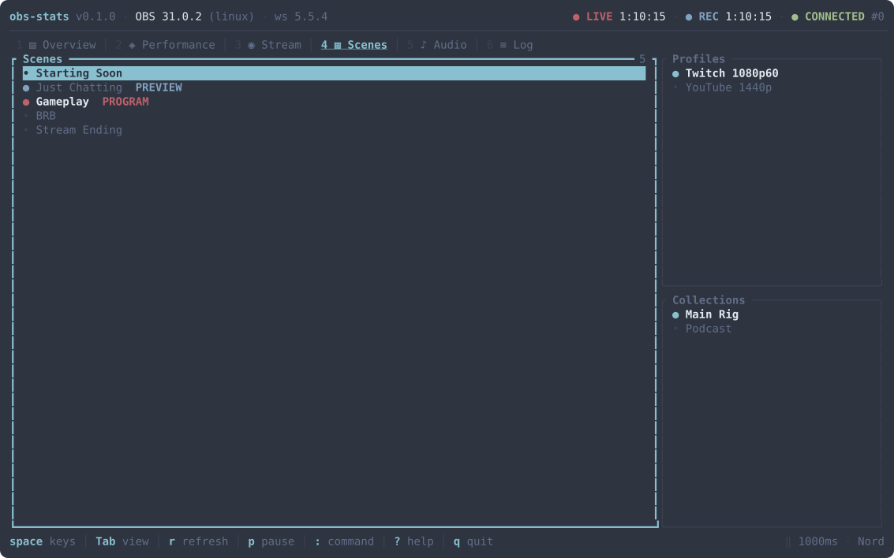
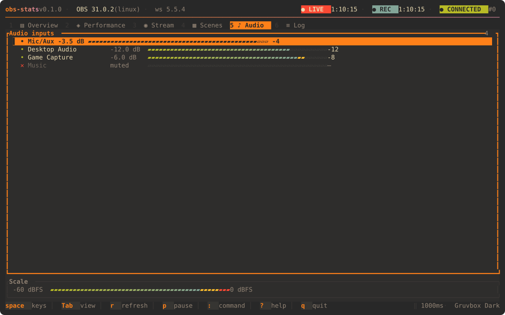
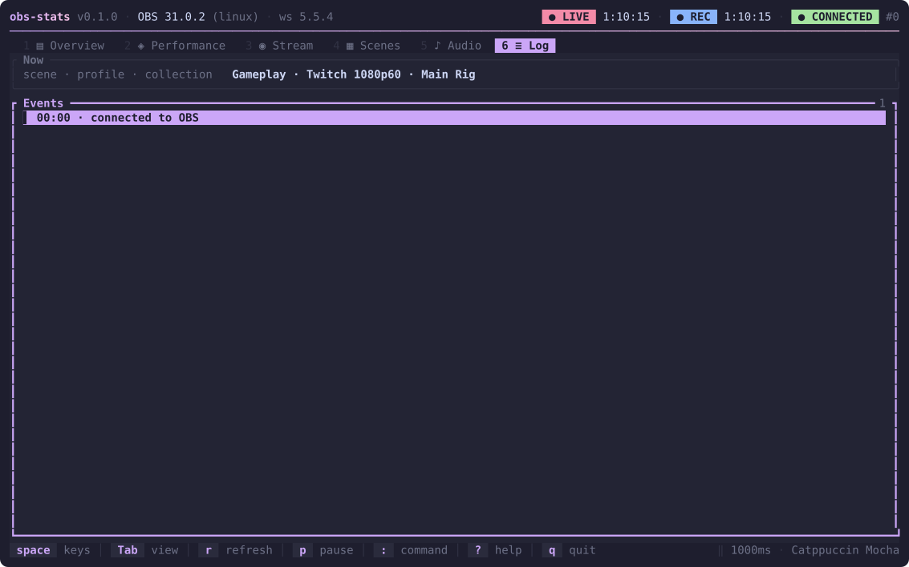
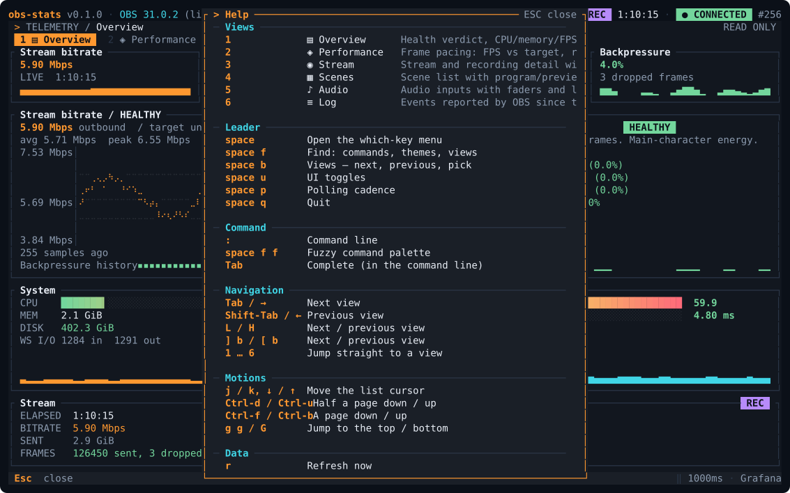
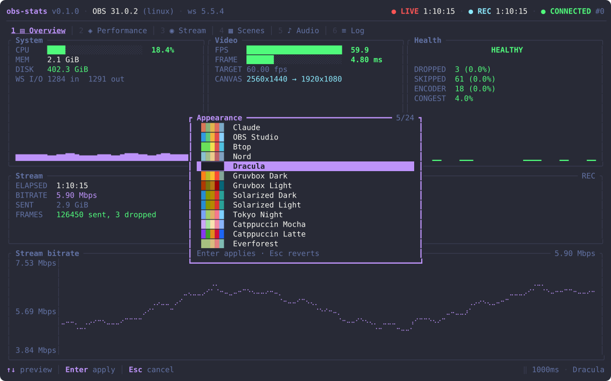

<div align="center">

# obs-stats

**A btop-style terminal dashboard for OBS Studio.**

Watch CPU, frame pacing, encoder health, outputs, scenes and audio — live, from a terminal, over obs-websocket 5.x.

[](https://github.com/worxbend/obs-stats/releases/latest)
[](https://github.com/worxbend/obs-stats/actions/workflows/ci.yml)
[](LICENSE)
[](https://www.rust-lang.org)
[](https://ratatui.rs)
[](https://github.com/obsproject/obs-websocket)

[Install](#-install) · [Quick start](#-quick-start) · [Views](#-the-views) · [Keys](#-keys) · [Themes](#-themes) · [Config](#-configuration) · [Site](https://worxbend.github.io/obs-stats/)



</div>

---

## ✨ Why

OBS's own stats dock tells you *that* frames were dropped. It does not tell you **which pipeline dropped them**, whether it started five minutes ago, or whether the cause was your CPU, your encoder, or your uplink.

`obs-stats` separates the three, tracks them over time, and turns them into a verdict you can read from across the room.

|   |   |
|---|---|
| 📊 **Six focused dashboards** | Overview, frame pacing, outputs, scenes, audio meters, and an event log — one keypress apart. |
| 🩺 **A real verdict** | `HEALTHY` / `STRAINED` / `DROPPING`, derived from drop rates, congestion, frame budget and FPS against target — not a single number. |
| 🎯 **Three loss channels, kept apart** | Renderer skips (your GPU), encoder skips (your CPU/encoder), network drops (your uplink). Different causes, different fixes. |
| ⏱️ **Per-stream counters** | Drops are measured from the moment the stream started, not since OBS launched — so yesterday's numbers don't hide today's problem. |
| 🎨 **24 built-in themes** | A btop-style live picker that restyles the whole UI as you move, with `Enter` to keep and `Esc` to revert. |
| ⌨️ **Keyboard-first** | Vim keys or arrows, digits to jump, mouse optional. Everything reachable without a menu. |
| 🔒 **Secret-safe by design** | The password comes from an environment variable and is never written to config, logs, or error messages. |
| 🤖 **Scriptable** | `obs-stats once` prints the same numbers as JSON with a stable schema and documented exit codes. |
| 🦀 **One static binary** | Pure Rust, ratatui + crossterm. No runtime, no daemon, no dependencies. |

> Screenshots on this page are rendered by the app itself — [`examples/screenshot.rs`](examples/screenshot.rs) draws real frames through ratatui's test backend and serialises the cell buffer to SVG, so the images cannot drift from the code. They use representative sample data.

---

## 📦 Install

### From a release

```sh
curl -fsSL https://raw.githubusercontent.com/worxbend/obs-stats/main/scripts/install.sh | sh
```

The script picks the right archive for your platform, verifies its SHA-256, and installs to `~/.local/bin`. Set `OBS_STATS_INSTALL_DIR` to install elsewhere.

Or grab a binary from the [releases page](https://github.com/worxbend/obs-stats/releases/latest) — Linux (x86-64, aarch64, musl), macOS (Intel, Apple Silicon), and Windows (x86-64).

### From source

```sh
cargo install --git https://github.com/worxbend/obs-stats
```

Requires Rust 1.88 or newer (2024 edition; ratatui 0.30 sets the floor).

---

## 🚀 Quick start

1. In OBS: **Tools → WebSocket Server Settings → Enable WebSocket server**. Note the port (4455 by default) and, under **Show Connect Info**, the password.

2. Export the password and run:

   ```sh
   export OBS_WEBSOCKET_PASSWORD='...'
   obs-stats
   ```

   If you turned authentication off in OBS, skip the export — `obs-stats` connects anonymously.

3. Press `?` for the key reference, `t` for themes, `q` to quit.

Watching OBS on another machine:

```sh
obs-stats --host 192.168.1.20 --port 4455
```

Writing a config so you don't repeat yourself:

```sh
obs-stats init          # writes ~/.config/obs-stats/config.yml
obs-stats config        # prints the effective settings
```

---

## 🖥️ The views

### Overview — `1`

The at-a-glance deck. System load, video pipeline, and a health verdict across the top; the live stream and recording outputs below; a bitrate chart along the bottom.


### Performance — `2`

Frame pacing in detail: achieved FPS against the configured target, average render time against the frame budget, and the three loss channels reported separately.



### Stream — `3`

Everything OBS reports about both outputs, with a bitrate chart and a congestion trend. Includes a "how much longer can I record?" estimate derived from the write rate and free disk space.



### Scenes — `4`

The scene list with the program and preview scenes tagged, plus the active profile and scene collection. Read-only: this is a monitor, not a control surface.



### Audio — `5`

Every audio-bearing input with its fader position and a live peak meter. Meters are drawn on a **dB scale**, so normal speech around −20 dBFS fills roughly two thirds of the bar instead of the ~10% a linear scale would show. The segment colour warns before you clip.



### Log — `6`

Scene switches, output state changes, mute toggles and source changes, timestamped relative to when `obs-stats` started — so "how long before the drop did the scene change?" is a subtraction you don't have to do.



---

## ⌨️ Keys

| Key | Action |
|---|---|
| `Tab` / `Shift-Tab` | Next / previous view |
| `→` `←` or `l` `h` | Next / previous view |
| `1` … `6` | Jump straight to a view |
| `j` `k` or `↓` `↑` | Move the list cursor |
| `PgDn` / `PgUp` | Move the cursor a page |
| `g` / `G` | Jump to top / bottom |
| `r` | Refresh now |
| `space` or `p` | Pause / resume the display |
| `+` / `-` | Poll faster / slower |
| `t` or `F2` | Theme picker |
| `u` | Toggle Unicode drawing |
| `?` or `F1` | Help overlay |
| `q`, `Esc`, `Ctrl-C` | Quit |

Pausing freezes the metrics but **not** the connection state — a paused dashboard still tells you when OBS goes away.

Mouse (unless `--no-mouse`): scroll to move a selection, click a tab to switch views.

Press `?` in the app for the same table, generated from the keymap itself.



---

## 🎨 Themes

Press `F2` or `t`. Moving the cursor restyles the entire UI live; `Enter` keeps it, `Esc` puts the old one back.



| id | name | | id | name |
|---|---|---|---|---|
| `claude` | Claude | | `kanagawa` | Kanagawa |
| `obs` | OBS Studio | | `rose-pine` | Rosé Pine |
| `btop` | Btop | | `one-dark` | One Dark |
| `nord` | Nord | | `monokai` | Monokai |
| `dracula` | Dracula | | `ayu-dark` | Ayu Dark |
| `gruvbox` | Gruvbox Dark | | `github-dark` | GitHub Dark |
| `gruvbox-light` | Gruvbox Light | | `github-light` | GitHub Light |
| `solarized-dark` | Solarized Dark | | `synthwave` | Synthwave |
| `solarized-light` | Solarized Light | | `matrix` | Matrix |
| `tokyo-night` | Tokyo Night | | `high-contrast` | High Contrast |
| `catppuccin-mocha` | Catppuccin Mocha | | `mono` | Mono (TTY-safe) |
| `catppuccin-latte` | Catppuccin Latte | | `everforest` | Everforest |

Set one permanently with `ui.theme` in the config, or per-run with `--theme <id>`. `obs-stats themes` lists them all.

On a Linux virtual console or any terminal without a good Unicode font, use `--ascii` (or `ui.unicode: false`). Borders, bars, meters, markers, separators **and the charts** all switch to ASCII — ratatui's own `Chart` and `Sparkline` draw with braille and block elements and have no ASCII mode, so `obs-stats` renders those itself. Pair it with `mono`, which never paints a background of its own:

```sh
obs-stats --ascii --theme mono
```

---

## ⚙️ Configuration

`obs-stats init` writes a fully commented `~/.config/obs-stats/config.yml`. Every key is optional.

```yaml
connection:
  host: 127.0.0.1
  port: 4455
  password_env: OBS_WEBSOCKET_PASSWORD   # the *name* of the variable, never the password
  connect_timeout_ms: 3000

ui:
  theme: claude
  poll_interval_ms: 1000    # hot metrics; scenes/inputs refresh at 1/10 this rate
  history_seconds: 120      # how much history the charts retain
  unicode: true
  show_icons: true
  mouse: true
  start_view: overview
```

Precedence is **defaults → config file → CLI flags**. `$OBS_STATS_CONFIG` overrides the file location.

The password is deliberately not a config field, so the file is always safe to commit and to paste into a bug report. See [docs/configuration.md](docs/configuration.md) for the full reference.

---

## 🤖 Scripting

`obs-stats once` connects, collects one full picture, prints it as JSON, and exits:

```sh
obs-stats once | jq '.video.active_fps, .stream.drop_percent, .health'
```

```json
{
  "obs":    { "version": "31.0.2", "websocket_version": "5.5.4", "platform": "linux" },
  "system": { "cpu_percent": 18.4, "memory_mib": 2140.0, "disk_free_mib": 412000.0 },
  "video":  { "active_fps": 59.94, "target_fps": 60.0, "average_frame_render_ms": 4.8, … },
  "frames": { "render_skipped": 61, "output_skipped": 18, … },
  "stream": { "active": true, "drop_percent": 0.0024, "congestion": 0.04, … },
  "health": "HEALTHY"
}
```

Exit codes are stable:

| Code | Meaning |
|---|---|
| `0` | Success |
| `1` | Terminal or I/O failure |
| `2` | Invalid configuration or flags |
| `3` | Could not connect / connection lost |
| `4` | Authentication failed or required |
| `5` | OBS request failed, timed out, or spoke unexpectedly |

---

## 🧭 How it works

```
OBS Studio ──obs-websocket 5.x──▶ session task ──Update──▶ Snapshot ──▶ ratatui
                                  (owns socket)            (the model)   (draws)
                 ◀──batched requests──
```

One background task owns the socket. It reconnects on its own with backoff, polls on a timer, and pushes updates at the UI over a channel. **The render loop never awaits OBS**, so an OBS that hangs or disappears degrades to a visibly stale dashboard rather than a frozen terminal.

Polling is split by cost. Every tick sends one batched request for `GetStats` + `GetStreamStatus` + `GetRecordStatus`. Every tenth tick adds scenes, inputs, profiles, collections and video settings — things that change on human timescales. Audio levels arrive as `InputVolumeMeters` events rather than being polled at all.

The layers are separable and separately tested: `obs` (protocol) → `metrics` (model, rates, history) → `tui` (pure rendering). The UI performs no I/O; the model holds no handles. 351 tests, no live OBS required.

---

## 📚 Documentation

- [Configuration reference](docs/configuration.md)
- [Reading the metrics](docs/metrics.md) — what each number means and what to do about it
- [Key bindings](docs/keybindings.md)
- [Themes](docs/themes.md)
- [Troubleshooting](docs/troubleshooting.md)

---

## 🛠️ Development

```sh
cargo test                                  # 351 tests, no OBS needed
cargo clippy --all-targets -- -D warnings
cargo fmt --check
cargo run --example screenshot -- --demo    # regenerate docs/images/*.svg
cargo run --example screenshot -- --demo --text   # dump layouts as plain text
```

---

## 📄 License

MIT — see [LICENSE](LICENSE).

Built with [ratatui](https://ratatui.rs) and [crossterm](https://github.com/crossterm-rs/crossterm), against [obs-websocket](https://github.com/obsproject/obs-websocket).
