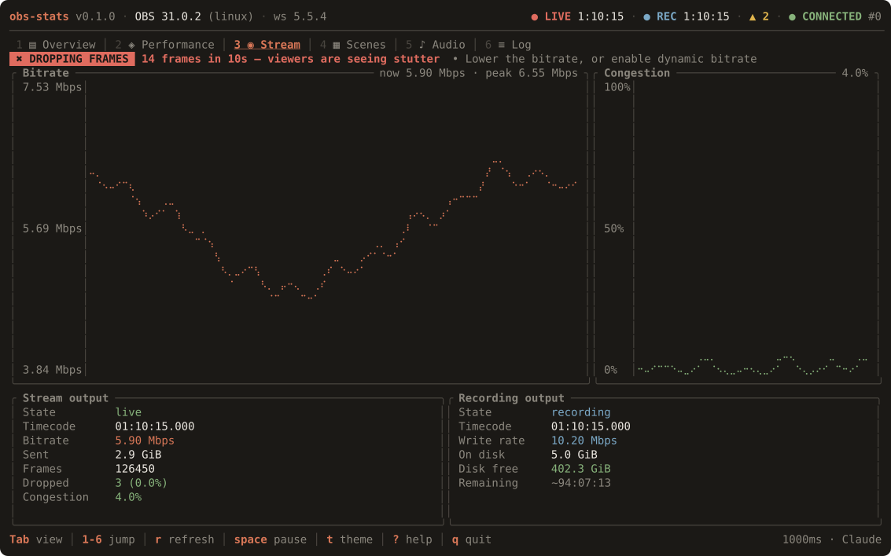

# Frame-loss alerts

`obs-stats` watches for frames actually being lost and tells you twice: a
banner across the dashboard, and a desktop notification so you find out even
when the terminal is behind your scene.



## What triggers one

Alerts are about **rate**, not totals. The panels answer "how many frames have
been lost?"; an alert has to answer "is something going wrong *right now*?",
and those come apart badly — a stream that dropped forty frames an hour ago and
none since is healthy.

So an alert fires when enough frames are lost **within a rolling window**:

| Alert | Cause | Severity |
|---|---|---|
| `DROPPING FRAMES` | The network could not deliver encoded frames | Critical |
| `RECONNECTING` | The stream dropped and OBS is re-establishing it | Critical |
| `ENCODER LAG` | The encoder could not keep up | Warning |
| `RENDER LAG` | The renderer could not build frames in time | Warning |

Network loss and a dropped stream are critical because a viewer sees them
directly. Encoder and renderer lag are warnings — bad, but often still
invisible downstream.

Each alert names the cause, the count, and what to change:

```
✖ DROPPING FRAMES  14 frames in 10s — viewers are seeing stutter  • Lower the bitrate, or enable dynamic bitrate
```

See [metrics.md](metrics.md) for why the three loss channels are kept apart and
what each one really means.

## What stops one

Four rules keep alerts worth reading:

- **A threshold.** One lost frame in a 60 fps stream is invisible, and is
  constant on some systems. The default needs 3 within 10 seconds.
- **A rolling window.** One frame every 30 seconds never accumulates — that is
  background noise, not a fault.
- **A cooldown.** A sustained problem alerts once a minute, not once a second.
- **An output.** Nothing fires unless a stream or recording is actually
  running. The renderer can skip while OBS sits idle; nobody is watching.

Two more, because a false alert costs more than a missed one:

- The **first poll only establishes a baseline**. Starting `obs-stats` during a
  healthy stream that dropped frames an hour ago will not alert on that history.
- A counter going **backwards** — which happens every time an output restarts —
  counts as zero loss, not as an enormous one.

## Where they show up

**A banner** under the tab strip, visible from every view. Critical banners
pulse and stay 45 seconds; warnings are steady and stay 20. Both clear
themselves, so a dashboard left running does not accumulate stale warnings. A
critical banner is never displaced by a warning while it is still up.

On a narrow terminal the banner drops the remedy hint rather than clipping it —
a half-printed instruction is worse than none.

**A counter** in the header (`▲ 3`) for everything raised this session. The
banner expires; the fact that frames were lost should not vanish with it.

**A log line** in the Log view (`6`), which keeps the full record with a
timestamp, so you can line a drop up against the scene switch that caused it.

**A desktop notification** — see below.

## Desktop notifications

On Linux, alerts also go to your desktop over D-Bus. Critical ones stay until
dismissed; warnings clear themselves after 8 seconds.

This speaks the freedesktop notification protocol directly with a pure-Rust
client, so there is no `libnotify` to install, no `notify-send` to shell out
to, and nothing extra to link — the binary stays static.

Delivery happens on its own thread. Showing a notification is a synchronous
round trip, and a desktop whose notification daemon has wedged would otherwise
stall the render loop — the one thing the whole architecture exists to prevent.

Notifications are skipped automatically when there is no session bus: a bare
TTY, an ssh session, a container. The banner still works. If the daemon fails
three times in a row, `obs-stats` stops trying for the session rather than
retrying forever.

Notifications are only implemented for Linux. On macOS and Windows the
dependency is not even compiled in, and alerts appear in the dashboard only.

### Testing yours

```sh
cargo run --example notification_check
```

It reports whether a session bus was found and whether the notifier started,
then sends one warning and one critical notification so you can see what they
look like.

## Configuration

```yaml
alerts:
  enabled: true          # detect frame loss at all
  desktop: true          # also send a desktop notification
  min_frames: 3          # frames lost within the window before alerting
  window_seconds: 10     # how far back to count. 1–600
  cooldown_seconds: 60   # minimum gap per cause. 0–3600
```

| Flag | Effect |
|---|---|
| `--no-notify` | Keep the banner, send no desktop notifications |
| `--no-alerts` | Turn the whole thing off |

### Tuning

**Too noisy?** Raise `min_frames`, or lengthen `cooldown_seconds`. A machine
that always skips a few render frames is better served by a higher threshold
than by turning alerts off.

**Not sensitive enough?** Lower `min_frames` to `1` and shorten
`window_seconds`. Setting `min_frames: 0` is treated as `1` — alerting on zero
lost frames would fire on every poll.

**Want to see one immediately while testing?** Set `cooldown_seconds: 0` and
`min_frames: 1`.

Alerts respect the pause key: a paused dashboard has no new metrics, so there
is nothing to alert on.
