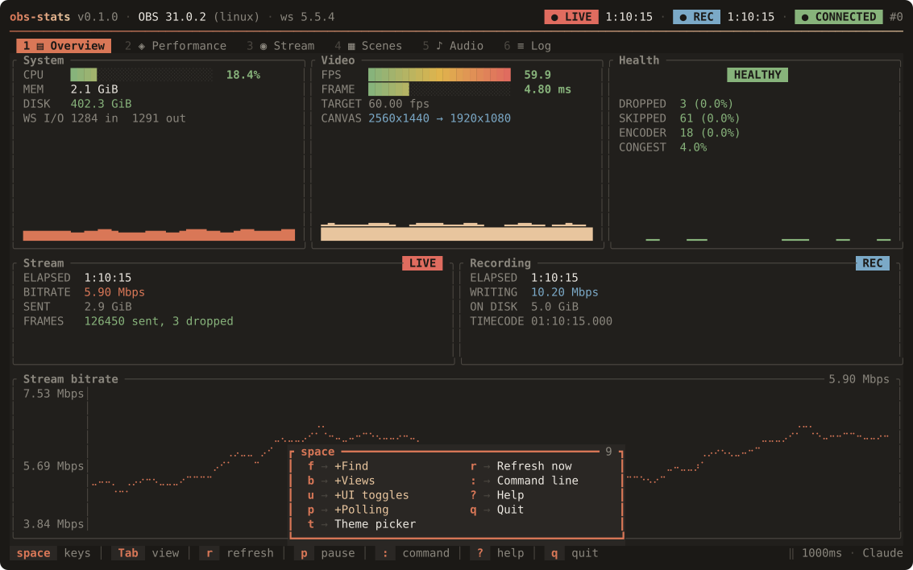
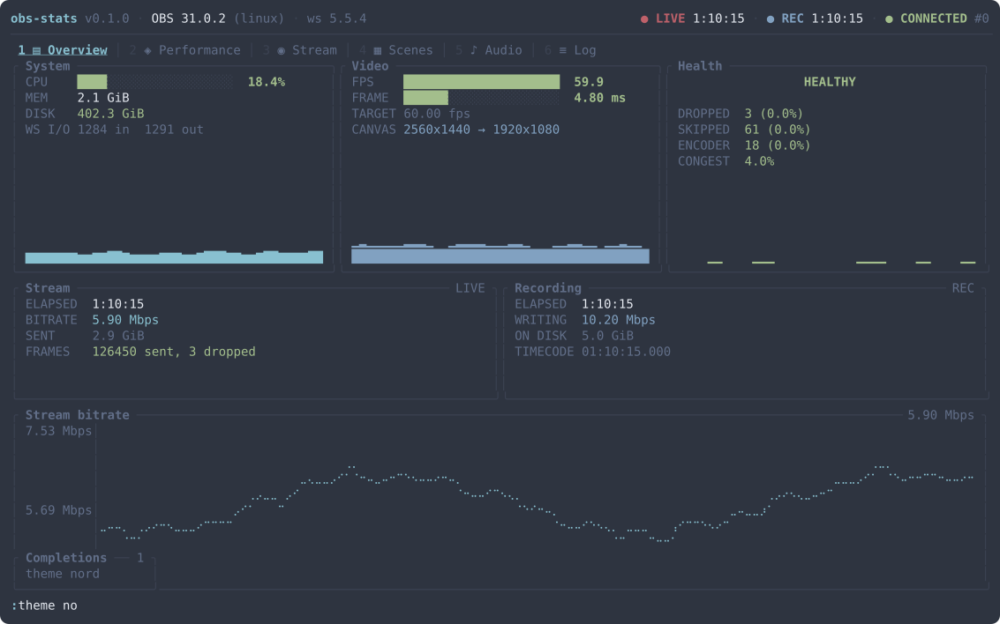
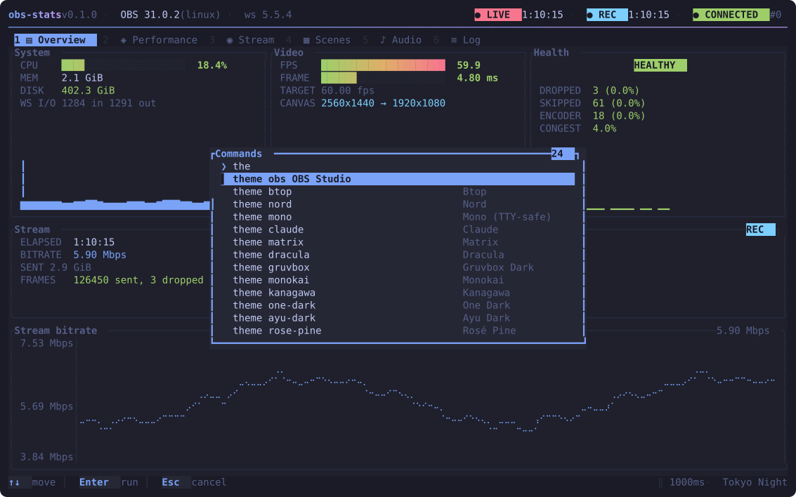

# Key bindings

The keymap is vim-shaped, laid out the way AstroNvim lays one out: `space` is
the leader and opens a which-key menu, `:` opens a command line, and the usual
motions work where a motion makes sense.

Press `?` or `F1` in the app for the same reference, generated from the keymap
itself — the two cannot drift apart.

Everything the app was bound to before the vim layer still works. The one
binding that changed shape is bare `g`, which is now the `gg` prefix rather than
"jump to top"; `Home` does that unchanged.

## The leader

`space` opens the which-key popup, which lists what is reachable from wherever
you are in a sequence. Keep typing to go deeper, `Esc` to back out.

| Sequence | Action |
|---|---|
| `space f f` | Fuzzy command palette |
| `space f t` | Palette, filtered to themes |
| `space f v` | Palette, filtered to views |
| `space b b` | Pick a view |
| `space b n` / `space b p` | Next / previous view |
| `space b 1` … `space b 6` | Jump to a view |
| `space u u` | Toggle Unicode drawing |
| `space u i` | Toggle the tab-strip icons |
| `space u p` | Pause or resume |
| `space u t` | Theme picker |
| `space p f` / `space p s` | Poll faster / slower |
| `space p r` | Refresh now |
| `space t` | Theme picker |
| `space r` | Refresh now |
| `space :` | Command line |
| `space ?` | Help |
| `space q` | Quit |

A key with no meaning at that point abandons the sequence rather than doing
something adjacent to what you meant.

## The command line

`:` opens a vim-style command line over the status row. `Tab` completes — the
command name first, then its argument — `Enter` runs, `Esc` cancels, and `↑`
walks back through what you have already run.

| Command | Aliases | Action |
|---|---|---|
| `:help` | `:h` | Show the key reference |
| `:view <id>` | `:buffer`, `:b` | Switch to a view by name |
| `:theme <id>` | `:colorscheme`, `:colo` | Apply a theme by name |
| `:poll <ms>` | `:interval` | Set the cadence, or `faster` / `slower` |
| `:refresh` | `:e` | Poll OBS immediately |
| `:pause` | | Freeze or resume the display |
| `:unicode` | `:ascii` | Toggle Unicode drawing |
| `:icons` | | Toggle the tab-strip icons |
| `:quit` | `:q`, `:qa`, `:exit` | Leave obs-stats |

A leading `set` is accepted and ignored, so `:set poll 500` and `:poll 500` are
the same command. `:theme` and `:view` with no argument open their picker rather
than erroring.

Anything wrong is reported in the status bar in words — `no such theme: puce` —
rather than failing silently.

## The command palette

`space f f` opens a fuzzy finder over the same registry the command line parses
against, plus a row per theme and per view. Type to filter, `↑` `↓` or `Ctrl-p`
/ `Ctrl-n` to move, `Enter` to run.

Matching is a subsequence match, so `ovw` finds `view overview`. Contiguous runs
and word starts score higher than scattered letters, which is what puts the
obvious answer on top.

## Navigation

| Key | Action |
|---|---|
| `Tab` / `Shift-Tab` | Next / previous view |
| `L` / `H` | Next / previous view |
| `] b` / `[ b` | Next / previous view |
| `→` / `l`, `←` / `h` | Next / previous view |
| `1` … `6` | Jump straight to a view |

## Motions

| Key | Action |
|---|---|
| `↓` / `j`, `↑` / `k` | Move the list cursor |
| `Ctrl-d` / `Ctrl-u` | Half a page down / up |
| `Ctrl-f` / `Ctrl-b`, `PgDn` / `PgUp` | A page down / up |
| `g g` / `Home` | Jump to the top |
| `G` / `End` | Jump to the bottom |

A page is one row shy of a screenful, measured from what the list actually
drew, so the row you were reading stays on screen.

The cursor clamps rather than wrapping: in a 500-line log, jumping from the
newest entry to the oldest on one keypress is disorienting.

Each view keeps its own cursor, so switching away and back does not lose your
place. If OBS deletes the scene you had selected, the cursor is pulled back into
range rather than pointing past the end.

Cursor keys only do something on views with a list — Scenes, Audio and Log.

## Views

| Key | View | Shows |
|---|---|---|
| `1` | Overview | Health verdict, CPU/memory/FPS gauges, live output cards |
| `2` | Performance | Frame pacing: FPS vs target, render budget, skip rates |
| `3` | Stream | Stream and recording detail with a live bitrate chart |
| `4` | Scenes | Scene list with program/preview, profiles and collections |
| `5` | Audio | Audio inputs with faders and live peak meters |
| `6` | Log | Events reported by OBS since this session started |

## Data

| Key | Action |
|---|---|
| `r` | Refresh now |
| `p` | Pause or resume the display |
| `+` / `=` | Poll faster (halve the interval) |
| `-` / `_` | Poll slower (double the interval) |

Pausing freezes the metrics but **not** the connection state — a paused
dashboard still shows you when OBS goes away.

Refreshing while paused resumes first. A refresh you cannot see would not be
what you meant.

The poll interval is clamped to 100–60000 ms. At either limit the key reports
that it is already there rather than silently doing nothing. Changing the rate
also resizes the history buffers, so the charts keep covering the same span of
time.

## Appearance

| Key | Action |
|---|---|
| `t` / `F2` | Open the theme picker |
| `u` | Toggle Unicode drawing |

In the picker, moving the cursor previews the theme across the **whole** UI, not
just a swatch. `Enter` keeps it; `Esc` puts the old one back. Neither writes to
the config file — set `ui.theme` for that.

`u` swaps every block glyph, meter segment and rounded border for an ASCII
equivalent. Useful on a Linux virtual console, over a serial link, or in any
terminal whose font lacks the box-drawing range. `--ascii` starts in that mode.

## General

| Key | Action |
|---|---|
| `?` / `F1` | Help overlay |
| `q` / `Esc` | Quit |
| `Ctrl-C` | Quit, from anywhere including overlays and mid-sequence |

`q` is a letter inside the command line and the palette, not a quit — `Esc`
closes those, and `Ctrl-C` still leaves from anywhere.

## Overlays

| Key | Action |
|---|---|
| `Enter` | Apply and close |
| `Esc` | Close, reverting the preview |
| `↑` `↓` `j` `k` `g` `G` `PgUp` `PgDn` | Move the selection |
| `Ctrl-w` / `Ctrl-u` | In a text input: rub out a word / the line |

While an overlay is open the dashboard keys are inert — `Tab` will not switch
views behind the help panel.

## Mouse

Enabled unless you pass `--no-mouse` or set `ui.mouse: false`.

| Gesture | Action |
|---|---|
| Scroll wheel | Move the list cursor |
| Left-click a tab | Switch to that view |
| Left-click a list row | Move the cursor to it |
| Drag inside a list | Sweep the cursor through it |
| Drag the scrollbar | Scrub to that point in the list |
| Left-click a row in an overlay | Select it; click again to apply |
| Left-click outside an overlay | Dismiss it, reverting any preview |
| Left-click `‖` / `PAUSED` | Pause or resume |
| Left-click the cadence | Poll faster |
| Left-click the theme name | Open the theme picker |
| Left-click the alert counter | Jump to the Log |

A scrollbar appears on the right border of a list only when the list is longer
than the panel, so a short list is not decorated with a bar that cannot move.

Right-clicks are ignored, so a stray click cannot change state. A click also
abandons a half-typed key sequence, the same way an unmapped key does.

Disable the mouse if you want your terminal's native text selection back —
mouse capture takes precedence over it.
